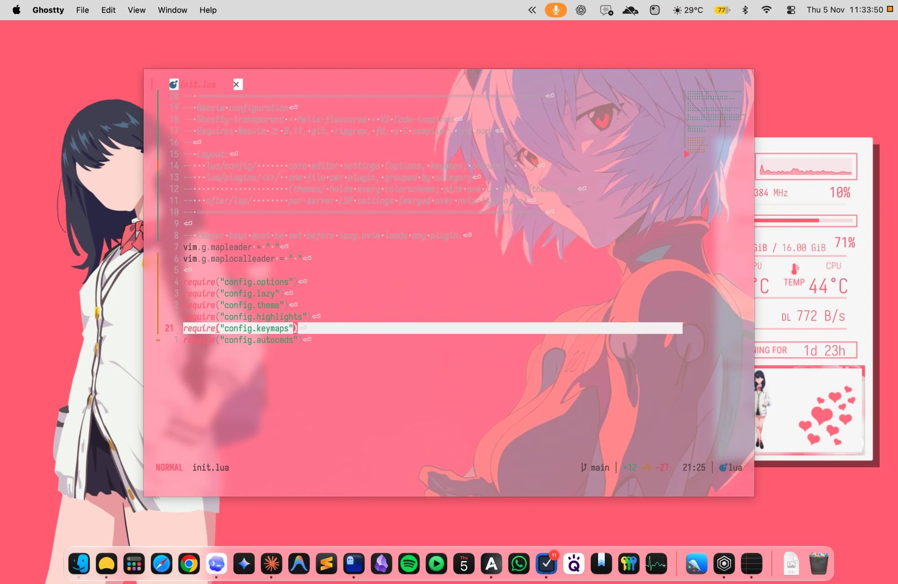

# LoveBites for macOS 💋

A macOS port of [flyingcakes85/LoveBites](https://github.com/flyingcakes85/LoveBites), plus my dotfiles.



| LoveBites (Linux) | macOS |
|---|---|
| Wallpaper | Same art, refit to 16:10 |
| conky | Übersicht widget (`ubersicht/lovebites.widget`), live CPU/RAM/temps (macmon)/net/uptime, light + dark |
| PapirusRed icons | Red Papirus icons on home folders (fileicon) |
| Xfwm/GTK theme | Light mode, red accent, pink highlight |
| Iosevka | Installed to `~/Library/Fonts` |
| — | Ghostty themes `LoveBites` / `LoveBites Dark` (auto light/dark) |
| — | fastfetch logo: red manga-eye art (`assets/terminal/fastfetch-logo.png`, kitty graphics in Ghostty) |
| — | Ghostty backdrop: Rei art (`assets/terminal/ghostty-bg.png`), dimmed into the theme color |
| — | Obsidian: animated writing pad, book-style Reading mode, writing statistics, bookshelf (`obsidian/`, see its README) |
| — | Neovim colorscheme `nvim/colors/lovebites.lua` (light + dark, follows Ghostty) |

## Two rices: LoveBites and Event Horizon

This branch adds a second rice, **Event Horizon** (`event-horizon/`, see its README): ink-black space, an accretion
disk of ice-white light with an ember rim. It covers the wallpaper, macOS appearance, Übersicht, Ghostty, Neovim,
fastfetch, Finder folders, Chrome and Obsidian. One command flips the whole Mac between the two.

### Fresh Mac

```bash
git clone -b event-horizon https://github.com/ZahinTapadar/lovebites-macos.git ~/Programming/lovebites-macos
cd ~/Programming/lovebites-macos
./setup.sh                 # or: ./setup.sh event-horizon
```

`setup.sh` installs the apps and fonts (Homebrew needed), wires Ghostty, fastfetch and Neovim to follow the active
rice (backing up your configs to `~/.config/rice/backup`), adds the `rice` command and **Switch Rice.app**, then
applies a rice. Chrome themes are loaded by hand; the script prints the folders.

### Switching

```bash
rice toggle          # flip to the other rice
rice event-horizon   # or name one: lovebites | event-horizon
rice                 # print the active one
```

Or click **Switch Rice** in `~/Applications` (⌘Space "Switch Rice"), or the **swap** button on the desktop widget.
Each rice's settings live in its `rice.sh`.

## LoveBites only (older installer)

```bash
./install.sh     # saves your current settings to ~/.lovebites-backup first
./uninstall.sh   # puts them back
```

`nvim/`, `ghostty/config` and `fastfetch/config.jsonc` are my full configs; the installer only copies the colorscheme and themes.

## Credits

Original rice, conky art, panel hearts: [flyingcakes85](https://github.com/flyingcakes85/LoveBites) (GPL-3.0-or-later, see `COPYING`).
Wallpaper: [Rikka Takarada Minimalist](https://www.deviantart.com/kiddblaster/art/Rikka-Takarada-Minimalist-785029419) by Kiddblaster. Not covered by the GPL.
Icons: Papirus (GPL-3.0).
